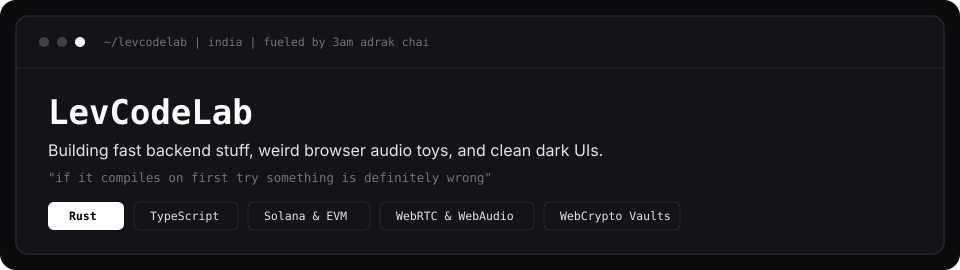

### Namaste, I am Prakhar

I am a systems and fullstack dev from India. I spend most nights building fast backend stuff, weird browser audio toys, and clean dark UIs. Everything here runs on pure divine code and 3am adrak chai.

### My Coding Rules

1. If it compiles on the first try, something is definitely wrong.
2. When I wrote this code only me and bhagwan knew how it worked. Now only bhagwan knows.
3. It is not a bug bhai, it is an undocumented surprise feature.
4. Clean 200 line jugaad > 50MB npm packages.

### Tech I Touch Daily

### All 18 Open Source Repos

Every repo below is small, tested, and ready to clone in 60 seconds.

#### Solana & Validator Speed

| Repo | What it does in plain words |
| :--- | :--- |
| [solana-fast-rpc](https://github.com/LevCodeLab/solana-fast-rpc) | Rust slot clock, 80% stake vote checker, and multi RPC normalizer |
| [solana-validator-stream](https://github.com/LevCodeLab/solana-validator-stream) | Local Unix socket Geyser plugin for fast validator slot updates |
| [solana-tx-router](https://github.com/LevCodeLab/solana-tx-router) | Rust QUIC leader router and priority fee math CLI |
| [solana-live-websocket](https://github.com/LevCodeLab/solana-live-websocket) | Lightweight Rust Axum WebSocket server for live slots and forks |
| [blockchain-speed-dashboard](https://github.com/LevCodeLab/blockchain-speed-dashboard) | Next.js visual playground for live block forks and finality speed |

#### Wallet Security & Browser Crypto

| Repo | What it does in plain words |
| :--- | :--- |
| [evm-wallet-shield](https://github.com/LevCodeLab/evm-wallet-shield) | Scans 7 EVM chains for shady `EIP 7702` delegations and burns bad nonces |
| [quantum-safe-wallet](https://github.com/LevCodeLab/quantum-safe-wallet) | Hash based post quantum key vault and Solana authority guard |
| [browser-encrypted-vault](https://github.com/LevCodeLab/browser-encrypted-vault) | Zero dependency browser `AES GCM 256` key vault in IndexedDB |

#### Trading Math, Leaderboards & UI Kits

| Repo | What it does in plain words |
| :--- | :--- |
| [token-swap-math](https://github.com/LevCodeLab/token-swap-math) | Clean `x * y = k` price impact, swap fee, and exit quote math |
| [multi-wallet-tracker](https://github.com/LevCodeLab/multi-wallet-tracker) | React + Viem `Multicall3` balance desk with automatic RPC failover |
| [crypto-pnl-leaderboard](https://github.com/LevCodeLab/crypto-pnl-leaderboard) | TypeScript + SQLite EVM wallet PnL scorer that catches fake insiders |
| [floating-chart-widget](https://github.com/LevCodeLab/floating-chart-widget) | Tiny Shadow DOM draggable overlay widget and Chrome MV3 starter |
| [ios-safari-fullscreen-pwa](https://github.com/LevCodeLab/ios-safari-fullscreen-pwa) | Fixes the annoying iOS Safari `100dvh` bottom blank bar bug |
| [evm-token-launchpad](https://github.com/LevCodeLab/evm-token-launchpad) | Solidity `0.8.24` bonding curve token factory with auto Uniswap V2 LP |

#### Browser Audio & Live Voice Rooms

| Repo | What it does in plain words |
| :--- | :--- |
| [live-voice-rooms](https://github.com/LevCodeLab/live-voice-rooms) | One click browser WebRTC voice rooms with a tiny WebSocket server |
| [wallet-voice-call](https://github.com/LevCodeLab/wallet-voice-call) | Encrypted wallet to wallet WebRTC voice calls with zero phone numbers |
| [lofi-music-generator](https://github.com/LevCodeLab/lofi-music-generator) | Zero MP3 LoFi music and vinyl crackle synth using Web Audio API |
| [live-listener-counter](https://github.com/LevCodeLab/live-listener-counter) | Heartbeat listener counter and streak tracker with zero npm bloat |

### Live Workspace Pulse

Updated automatically by GitHub Actions using `GITHUB_TOKEN`.

<!-- LIVE_PULSE:START -->
| Metric | Current Value |
| :--- | :--- |
| Public Open Source Repos | `19` |
| Core Languages | `TypeScript, Solidity, JavaScript, Rust` |
| Chai Powered Build Status | `PASSING` |
| Last Automated Sync | `2026-11-21 19:47 UTC` |
<!-- LIVE_PULSE:END -->
